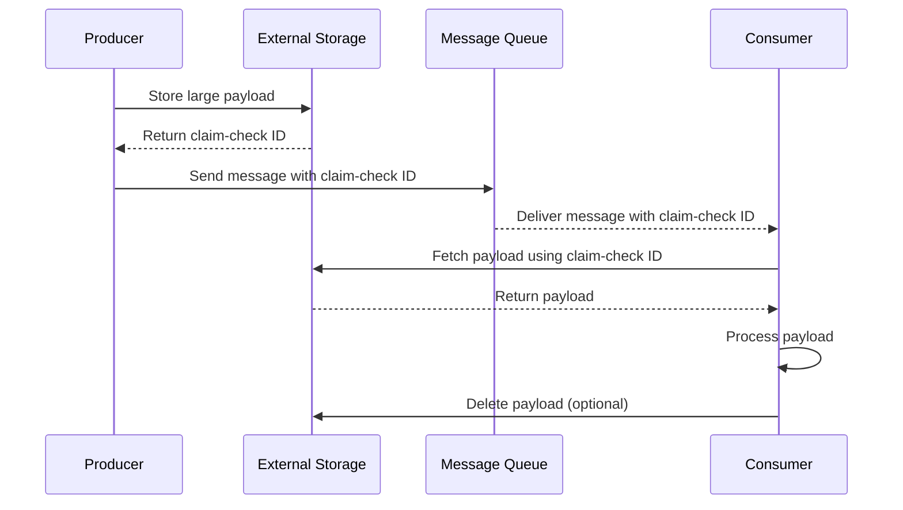

# Claim Check Pattern

## Overview

The **Claim Check Pattern** is a messaging pattern that allows large messages to be processed in systems with message size limitations. Instead of sending the entire message payload, a reference (claim check) is sent, while the actual payload is stored in a separate, accessible location.

This pattern is analogous to a coat check at a restaurant: you receive a small ticket (claim check) that can be used to retrieve your actual coat (payload) when needed.

---

## Context

### Problem Statement
Many messaging systems impose size limits on messages:
- **Kafka**: Default max message size is 1MB (configurable, but large messages impact performance)
- **RabbitMQ**: Default max message size varies by broker configuration
- **AWS SQS**: Standard queues have a 256KB limit, FIFO queues have 256KB
- **Azure Service Bus**: Max message size is 256KB (Standard) or 1MB (Premium)
- **HTTP APIs**: Payload size limits, timeout constraints

When message payloads exceed these limits, the system cannot process them directly.

### When to Use
- Message payloads regularly exceed system size limits
- Payload processing is deferred or optional
- Multiple consumers need access to the same large payload
- Payload retrieval should be decoupled from message processing

### When NOT to Use
- Messages are consistently small (< 100KB)
- Low-latency requirements make additional retrieval unacceptable
- Payload must be processed immediately with the message
- Simple in-memory processing is sufficient

---

## Solution

### Implementation Steps
1. **Producer stores payload** in storage (S3, DB, etc.)
2. **Generate claim check** - storage returns unique reference
3. **Send message with reference** - small message to broker
4. **Broker delivers message** normally
5. **Consumer retrieves payload** using claim check
6. **Process complete** with full payload
