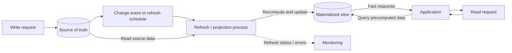

# Materialized Views
*Problem*: Data storage/storage organization is often optimized for writing - this often results in slow queries.
*Solution*: Materialized views pre-computing a read-optimized view, which is usually specific for a (type) of query.

## When to use
* Direct query is difficult or compute intense
* Expose a specific subset of data (privacy, security, ...)
* Consolidate data from loosely coupled micro services

## When to not use
* Simple source data
* Rapidly changing source data
* High requirements for consistency

## Considerations
* Refresh strategy
* Refresh costs
* Rebuilding on loss 

[Reference](https://learn.microsoft.com/en-us/azure/architecture/patterns/materialized-view)
